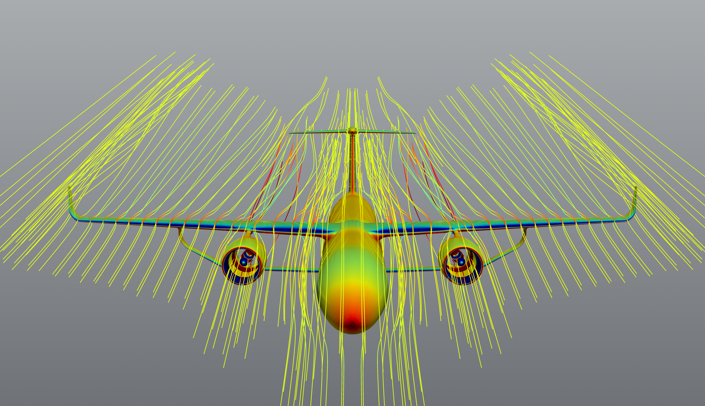

# Kajetan R. Gułaj

After simulating and validating the tiny and small wing-body cases from the NASA Drag Prediction Workshop, I wanted something a bit harder. I ended up "vibecoding" NASA/Boeing's Transonic Truss-Braced Wing, since I didn't have exact drawings.

I speed-ran the aerospace design and systems engineering cycle and adapted geometry. Then I quickly learned what a non-working engine does to a flow, and went down a deep dive into simulating turbofans. After none of my educated guesses for the engine position worked (maybe eyeballing aircraft photos isn't that educated after all), I took a tangent into sensitivity analysis, using adjoint and finite-difference gradients to place it properly.

The result is an ultra-long-range, single-aisle, state-of-the-art-efficient aircraft that makes absolutely no economic sense. But hey, at least the picture is good ;)

## Contact

[LinkedIn](https://www.linkedin.com/in/kajetan-r-gulaj/) · kajetan.gulaj@gmail.com
